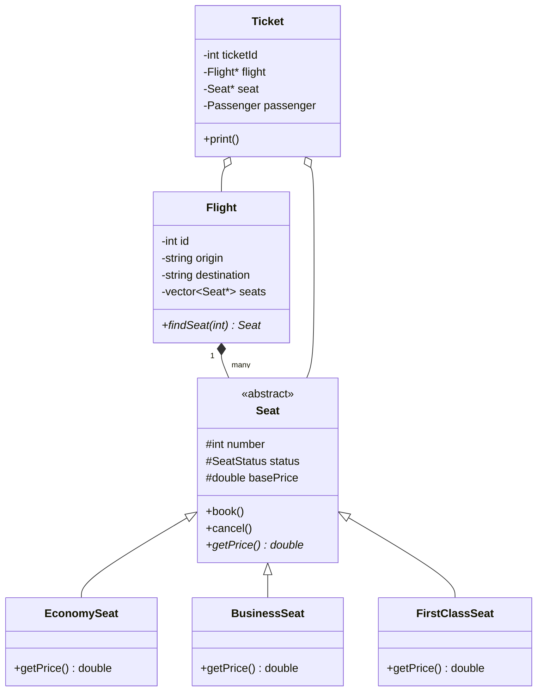

# ✈️ Enterprise Flight Reservation & Ticketing System (C++17)

> **Production-Grade Aviation Scheduling & Ticketing Architecture**: Multi-Class Cabin Management, Polymorphic Seat Hierarchies, Dynamic Fare Calculations, and Payment Gateways.

---

## 🏛️ Class & Inheritance Architecture



---

## 🌟 Core Highlights

1. **Polymorphic Seat Pricing**:
   - `Seat` base class with virtual dynamic pricing overridden by `EconomySeat`, `BusinessSeat`, and `FirstClassSeat`.
   - Distinct cabin amenity multipliers and boarding privileges.

2. **Flight Scheduling & Fleet Management**:
   - Flight routing (Origin, Destination, Departure Time, Capacity).
   - Real-time seat layout visualization (Booked vs Available).

3. **Booking Lifecycle & Transaction Security**:
   - Ticket reservation, seat allocation locking, and ticket cancellation workflows.
   - Dual payment processing (Cash / Card) with status validations.

4. **Multi-Role Operator Access**:
   - **Administrator**: Flight creation, seat configuration, route modifications, and booking registry audit.
   - **Passenger**: Browse routes, select seats, book tickets, view itineraries, and process cancellations.

---

## 🛠️ Build & Run

### Direct Build (g++)
```bash
g++ -std=c++17 -O2 -Wall -Wextra main.cpp -o AirlineReservationSystem
./AirlineReservationSystem
```

### CMake Build
```bash
mkdir build && cd build
cmake ..
cmake --build .
./AirlineReservationSystem
```

